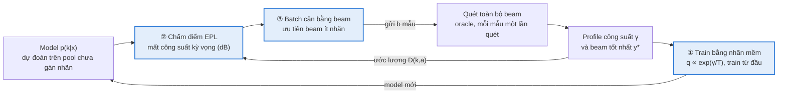
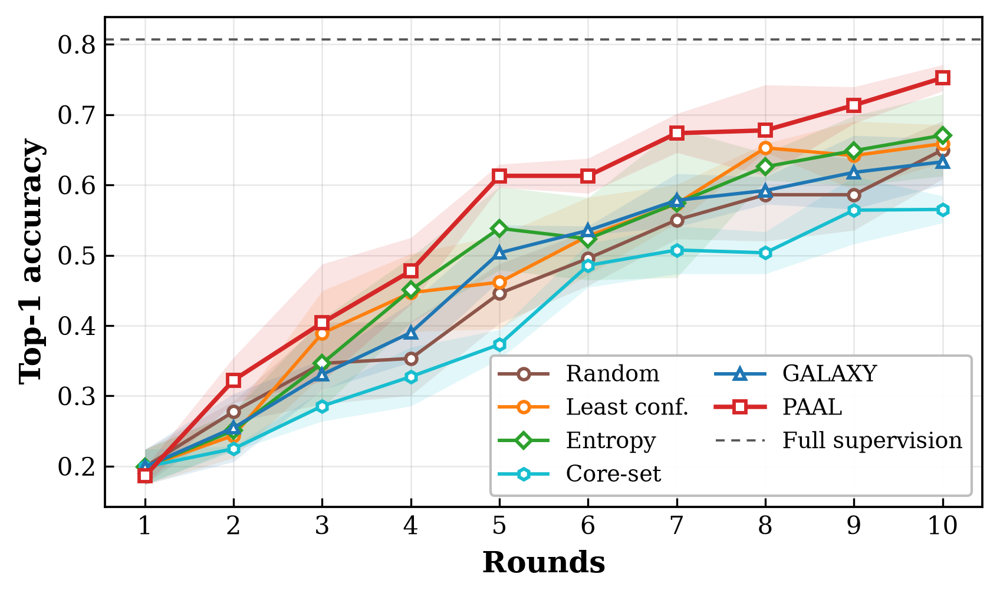
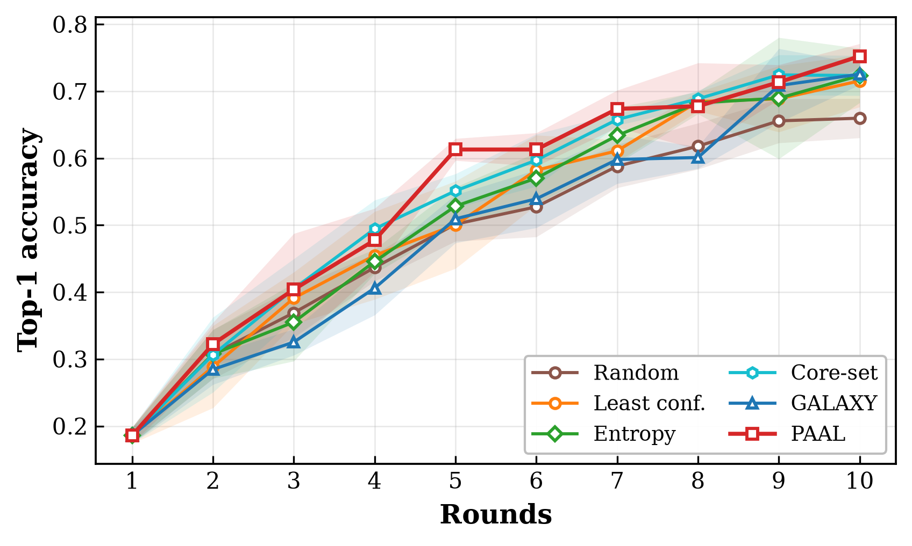

# Đề xuất nghiên cứu: PAAL — Học chủ động nhận biết công suất cho chọn beam mmWave

*Cập nhật: 2026-10-08 (kết quả 3 seed trên FLASH LiDAR)*

## Tóm tắt

Đề xuất PAAL (Power-Aware Active Learning), một framework học chủ động cho chọn beam mmWave dùng trọn vẹn phản hồi vật lý của mỗi lần quét beam để giảm số mẫu phải gán nhãn.

Mỗi nhãn trong bài toán này đến từ một lần quét toàn bộ codebook, và lần quét đó đo công suất của **mọi** beam. Các phương pháp active learning (AL) hiện có, kể cả công trình duy nhất áp dụng AL cho chọn beam (Soltani et al., 2024), chỉ giữ lại chỉ số beam tốt nhất. PAAL khai thác profile công suất ở ba chỗ:

1. **Học:** train bằng nhãn mềm theo công suất, không tốn thêm chi phí đo.
2. **Chọn mẫu:** ưu tiên mẫu có độ mất công suất kỳ vọng (dB) lớn nhất nếu dùng beam model đang chọn.
3. **Tạo batch:** cân bằng theo beam dự đoán để phủ các beam hiếm trong dữ liệu mất cân bằng nặng.

Đóng góp dự kiến gồm framework PAAL và một benchmark 11 phương pháp AL trên FLASH và DeepSense 6G, hai modality ảnh và LiDAR. Kết quả 3 seed trên FLASH LiDAR: PAAL đạt AUC 0.562 ± 0.013, hơn baseline tốt nhất dùng nhãn cứng (entropy, 0.469) 9,3 điểm và hơn baseline tốt nhất cùng dùng nhãn mềm (Core-set, 0.525) 3,7 điểm; PAAL thắng ở cả 3 seed.

## Bối cảnh và động lực

Chọn beam bằng deep learning giúp giảm overhead khi vận hành, nhưng dữ liệu train vẫn phải gán nhãn bằng cách quét toàn bộ beam ở từng vị trí. FLASH báo cáo model đa phương thức giảm 57% thời gian chọn beam so với quét toàn bộ. Tuy vậy, để train model đó cần hàng chục nghìn mẫu, mỗi mẫu một lần quét.

Chi phí gán nhãn này lặp lại mỗi khi đổi môi trường, thiết bị hoặc codebook. Active learning giảm chi phí bằng cách chỉ gán nhãn những mẫu đáng giá nhất. Soltani et al. (2024) cho thấy GALAXY tiết kiệm tới 50% nhãn trên FLASH.

Bài toán chọn beam có ba đặc tính mà AL tổng quát không khai thác:

- **Oracle trả về nhiều hơn một nhãn.** Lần quét cho công suất của mọi beam, không chỉ beam tốt nhất.
- **Lỗi không ngang nhau.** Chọn nhầm sang beam kề bên có thể chỉ mất dưới 1 dB; chọn nhầm sang beam xa có thể mất hàng chục dB.
- **Dữ liệu mất cân bằng nặng.** Trên FLASH, lớp nhỏ nhất có 20 mẫu và lớp lớn nhất 6 882 mẫu, trong khi tập test cân bằng lớp.

PAAL được thiết kế để biến cả ba đặc tính này thành lợi thế.

## Công trình liên quan và research gap

Năm hướng liên quan đều chạm tới một phần vấn đề, nhưng chưa hướng nào đưa phản hồi vật lý của lần quét beam vào vòng active learning.

| Hướng | Đại diện | Còn thiếu |
| --- | --- | --- |
| AL cho viễn thông | [Soltani et al., 2024](https://arxiv.org/abs/2402.04896): GALAXY trên FLASH | AL tổng quát; 3 phương pháp, 1 dataset; mỗi lần quét chỉ là một nhãn one-hot |
| AL cho dữ liệu mất cân bằng | [GALAXY](https://arxiv.org/abs/2202.01402) (ICML 2022) | Không dùng cấu trúc beam hay công suất |
| Nhãn mềm theo công suất beam | Knowledge distillation cho beam tracking ([arXiv:2509.11419](https://arxiv.org/html/2509.11419), [arXiv:2604.16708](https://arxiv.org/abs/2604.16708)) | Dùng để nén model khi đủ nhãn, không nằm trong vòng AL |
| Giảm nhãn bằng tự giám sát | JEPA cho 6G ([arXiv:2607.09798](https://arxiv.org/pdf/2607.09798)), [CM-MAE](https://arxiv.org/pdf/2608.15972) | Pretraining, không chọn mẫu nào để gán nhãn |
| AL nhạy chi phí lỗi | [COAL](https://arxiv.org/pdf/1703.01014): oracle trả cả vector chi phí | Model tuyến tính; chưa có cho deep learning hay ma trận chi phí vật lý |

Từ đó có năm gap:

- **G1. Phản hồi của oracle bị bỏ phí.** Lần quét đo mọi beam nhưng AL chỉ giữ chỉ số beam tốt nhất. Đây là bài toán "oracle trả về vector chi phí" kiểu COAL, nhưng chưa có cho deep AL chọn beam.
- **G2. Tiêu chí chọn mẫu không khớp mục tiêu vận hành.** Entropy, margin hay GALAXY coi mọi lỗi như nhau, nên có thể phí nhãn vào mẫu phân vân giữa hai beam gần tương đương.
- **G3. Mất cân bằng chỉ được xử lý bằng phương pháp tổng quát.** Chưa có phương pháp nào kết hợp cân bằng lớp với G1 và G2.
- **G4. Dữ liệu là chuỗi frame 10 Hz nhưng AL coi mẫu là độc lập.** Đã có lời giải cho video xe tự lái ([Temporal Coherence for AL in Videos](https://ar5iv.labs.arxiv.org/html/1908.11757)), chưa có cho dữ liệu beam. Gap này yếu hơn: thử nghiệm trước của nhóm chưa thấy lợi ích.
- **G5. Đánh giá chưa chặt.** Chưa có so sánh nhiều phương pháp trên nhiều dataset và modality, cũng chưa có đánh giá tách theo episode để loại frame gần trùng giữa train và test.

Mới tra cứu bằng web search, chưa tra Google Scholar hay IEEE Xplore một cách hệ thống; cần làm trước khi nộp bài.

## Phương pháp đề xuất: PAAL

PAAL giữ nguyên vòng AL chuẩn theo pool và thay ba chỗ: cách học, tiêu chí chọn mẫu và cách tạo batch. Cả ba dùng profile công suất γ (dB) mà lần quét trả về, nên không tốn thêm chi phí đo.

Mỗi lần quét trả về profile γ; γ vừa làm nhãn mềm cho ①, vừa dùng ước lượng ma trận D cho ②.

**Ký hiệu.** K beam; mẫu x có beam tốt nhất y\* và công suất γₖ(x); model cho xác suất p(k|x); L là tập đã gán nhãn, U là pool chưa gán nhãn, b là kích thước batch.

### ① Học từ profile công suất (G1)

Nhãn mềm lấy từ lần quét, với nhiệt độ T tính bằng dB:

$$
q_k(x) = \frac{\exp(\gamma_k(x)/T)}{\sum_{j=1}^{K} \exp(\gamma_j(x)/T)}
$$

Loss kết hợp nhãn cứng và nhãn mềm:

$$
\mathcal{L} = (1-w)\,\mathrm{CE}\big(y^{*}, p\big) + w\,\mathrm{CE}\big(q, p\big)
$$

Thiết lập ban đầu: T = 1 dB, w = 0,5. Model học được rằng các beam chỉ kém beam tốt nhất vài dB cũng gần đúng.

### ② Chọn mẫu theo độ mất công suất kỳ vọng (G2)

Từ các lần quét đã có, ước lượng ma trận mất công suất khi chọn beam a trong khi beam tốt nhất là k:

$$
D(k,a) = \frac{1}{|L_k|} \sum_{x \in L_k} \big(\gamma_k(x) - \gamma_a(x)\big), \quad L_k = \{x \in L : y^{*}(x) = k\}
$$

Điểm của mỗi mẫu chưa gán nhãn là độ mất công suất kỳ vọng nếu dùng beam model đang chọn:

$$
\mathrm{EPL}(x) = \sum_{k=1}^{K} p(k \mid x)\, D\big(k, \hat{a}(x)\big), \quad \hat{a}(x) = \arg\max_a p(a \mid x)
$$

EPL đo đúng đại lượng lúc vận hành (dB bị mất), khác với entropy vốn coi mọi lỗi như nhau. Lớp chưa có mẫu nào được gán nhãn thì D(k,·) lấy từ giá trị trung bình của các lớp còn lại.

### ③ Tạo batch cân bằng theo beam (G3)

Gom các mẫu trong U theo beam dự đoán â(x). Lặp cho đến khi đủ b mẫu: chọn beam đang có ít nhãn nhất trong L (tính cả mẫu đã chọn trong batch), rồi lấy mẫu có EPL cao nhất trong nhóm đó. Cách này phủ beam hiếm như GALAXY nhưng chỉ cần một vòng sắp xếp.

### Thuật toán

1. Gán nhãn ngẫu nhiên 5% pool, lưu cả y\* và γ.
2. Train model từ đầu bằng loss ① cho đến khi hội tụ.
3. Ước lượng D từ L; tính EPL cho mọi mẫu trong U.
4. Tạo batch b mẫu theo ③ và gửi đi quét beam.
5. Thêm vào L; lặp lại từ bước 2 cho đến khi hết ngân sách (50% pool).

## Thiết kế thí nghiệm

Mọi thí nghiệm dùng chung một protocol theo Soltani et al. (2024), đã cài đặt trong repo `alwl`, với ngân sách thu gọn về vùng ít nhãn.

| Hạng mục | Thiết lập |
| --- | --- |
| Dataset | FLASH (34 sector, 31 363 mẫu), DeepSense 6G scenario 33 (64 beam, khoảng 3 980 mẫu) |
| Modality | Ảnh (ResNet18, 3×90×160) và LiDAR (CNN 3D, 20×20×20) |
| Chia dữ liệu | Xáo từng mẫu, test 10 mẫu mỗi lớp (cân bằng); thêm bản tách theo episode để kiểm tra độ bền |
| Ngân sách | 5% pool ban đầu, thêm 5% mỗi vòng, tới 50%; mốc 100% từ train toàn bộ pool |
| Train | Từ đầu mỗi vòng, dừng khi loss hội tụ (tối đa 60 epoch) |
| Baseline | 11 phương pháp: random, least confidence, margin, entropy, BALD, Core-set, BADGE, BAIT, GALAXY, TypiClust, ProbCover |
| Chỉ số | Top-1, top-5, AUC theo số nhãn, số nhãn để đạt mục tiêu và % tiết kiệm so với random, per-class min queries, độ mất công suất trung bình (dB) |
| Lặp lại | 3 seed khi thử ý tưởng, 5 seed cho kết quả cuối |

**Ablation bắt buộc.** Để tách đóng góp của từng thành phần:

- ① đơn lẻ: random + nhãn mềm so với random + nhãn cứng.
- ② so với các tiêu chí khác, cùng dùng nhãn mềm: EPL so với entropy, margin, GALAXY.
- ③ thêm hay bỏ trên nền ① + ②.
- Các baseline mạnh nhất cộng nhãn mềm, để chứng minh lợi ích của PAAL không chỉ đến từ cách học.
- Độ nhạy theo T và w.

**Tiêu chí thành công.** PAAL thắng baseline tốt nhất về AUC và số nhãn để đạt mục tiêu ở **mọi seed**, trên cả FLASH và DeepSense, cả ảnh và LiDAR.

## Kết quả trên FLASH LiDAR (3 seed)

PAAL thắng mọi baseline ở cả 3 seed: AUC 0.562 ± 0.013, so với 0.469 của baseline tốt nhất dùng nhãn cứng và 0.525 của baseline tốt nhất cùng dùng nhãn mềm.

Thiết lập: FLASH LiDAR, seed 1, 10, 100; 5% → 50% pool, mỗi vòng thêm 5% (1 551 mẫu; vòng 1 = 5%, vòng 10 = 50%); dải mờ = ± 1 độ lệch chuẩn giữa các seed; AUC = trung bình top-1 trên 10 mốc. Mọi cấu hình cùng split và cùng tập mẫu ban đầu ở mỗi seed. Train toàn bộ pool đạt top-1 0.821 (đường nét đứt trong hình).

**(a) So với baseline dùng nhãn cứng (như bài báo gốc)**

**(b) So với baseline cùng dùng nhãn mềm**

| Phương pháp | Nhãn | AUC top-1 (± std) | AUC top-5 | @20% | @30% | @50% | Nhãn để đạt 60% | Nhãn để đạt 70% |
| --- | --- | --- | --- | --- | --- | --- | --- | --- |
| Random | cứng | 0.442 ± 0.003 | 0.726 | 0.386 | 0.452 | 0.636 | 13 959 | không đạt |
| Least conf. | cứng | 0.467 ± 0.007 | 0.751 | 0.417 | 0.504 | 0.671 | 13 959 | không đạt |
| Entropy | cứng | 0.469 ± 0.029 | 0.753 | 0.393 | 0.534 | 0.677 | 10 857 | không đạt |
| GALAXY | cứng | 0.466 ± 0.010 | 0.743 | 0.427 | 0.496 | 0.647 | 13 959 | không đạt |
| Core-set | cứng | 0.392 ± 0.009 | 0.703 | 0.341 | 0.435 | 0.576 | không đạt | không đạt |
| Random | mềm | 0.486 ± 0.005 | 0.759 | 0.415 | 0.528 | 0.661 | 10 857 | không đạt |
| Least conf. | mềm | 0.496 ± 0.016 | 0.780 | 0.431 | 0.547 | 0.681 | 10 857 | 13 959 |
| Entropy | mềm | 0.507 ± 0.013 | 0.786 | 0.456 | 0.563 | 0.675 | 10 857 | không đạt |
| GALAXY | mềm | 0.510 ± 0.007 | 0.789 | 0.438 | 0.573 | 0.706 | 10 857 | 13 959 |
| Core-set | mềm | 0.525 ± 0.009 | 0.796 | 0.452 | 0.599 | 0.743 | 10 857 | 15 510 |
| **PAAL** | mềm | **0.562 ± 0.013** | **0.800** | **0.506** | **0.622** | **0.754** | **9 306** | **10 857** |

"Không đạt" = chưa chạm mốc trong ngân sách 50% pool (15 510 nhãn). Số nhãn đọc trên đường trung bình 3 seed, độ phân giải 1 551 nhãn.

AUC theo từng seed:

| Seed | PAAL | Baseline tốt nhất khác | Chênh lệch |
| --- | --- | --- | --- |
| 1 | 0.575 | 0.522 (Core-set, mềm) | +5,3 |
| 10 | 0.544 | 0.537 (Core-set, mềm) | +0,7 |
| 100 | 0.567 | 0.516 (Core-set, mềm) | +5,1 |

Nhận định:

- **Bảng chính:** PAAL hơn baseline tốt nhất dùng nhãn cứng 9,3 điểm AUC. Để đạt 60% accuracy, PAAL cần 9 306 nhãn, ít hơn random 33% và ít hơn entropy 14%. Không baseline nhãn cứng nào đạt 70% trong ngân sách; PAAL đạt ở 10 857 nhãn (35% pool).
- **Bảng công bằng:** khi mọi baseline cũng dùng nhãn mềm, PAAL vẫn hơn baseline tốt nhất 3,7 điểm. Khoảng cách lớn nhất ở vùng 20–35% pool; tới 50% pool Core-set + nhãn mềm gần bắt kịp (0.743 so với 0.754).
- **Nhãn mềm giúp mọi phương pháp:** AUC tăng từ +2,9 (least confidence) tới +13,3 điểm (Core-set). Điều này xác nhận thành phần ① và cho thấy bảng công bằng là bắt buộc.
- **Seed 10 là điểm yếu:** PAAL chỉ hơn Core-set + nhãn mềm 0,7 điểm. Cần thêm seed (5 seed như protocol) trước khi khẳng định mức chênh trung bình 3,7 điểm.
- **Ablation ② và ③** mới có 1 seed (seed 1): entropy + nhãn mềm 0.518 → EPL 0.552 → PAAL 0.575.

## Rủi ro, hạn chế và phương án dự phòng

Rủi ro lớn nhất là thành phần ② không thắng được entropy; khi đó đóng góp dời về ① + ③ và benchmark.

| Rủi ro | Vì sao | Phương án |
| --- | --- | --- |
| ② không thắng entropy | Một ý tưởng tương tự (chọn theo rủi ro mất SNR, RADIAL) từng không thắng Core-set, dù khi đó benchmark DeepSense đã chạm trần | Kiểm ② riêng trên FLASH còn khoảng trống; thua ở cả 3 seed thì bỏ |
| Nhãn mềm không phải điểm mới | Đã có công trình distillation dùng phân bố công suất beam | Đặt điểm mới ở việc dùng nó trong vòng AL, nhất là cho bước chọn mẫu |
| Nhãn mềm trên FLASH thiếu | Mỗi mẫu chỉ đo khoảng 16/34 sector, sector chưa đo gán bằng mức nền | Kiểm chứng trên DeepSense (đo đủ 64 beam) |
| Phân chia theo mẫu làm kết quả cao hơn thực tế | Frame 10 Hz gần trùng có thể nằm cả ở train lẫn test | Thêm kết quả tách theo episode |
| Nhiễu lớn | 1 seed dao động ±5 điểm giữa các mốc; test FLASH chỉ 335 mẫu | 3 seed khi thử, 5 seed cho kết quả cuối |
| Thời gian GPU | Image trên FLASH chậm hơn LiDAR nhiều lần | Phát triển trên LiDAR, chạy image khi thiết kế đã chốt |

PAAL chỉ áp dụng được khi oracle đo công suất nhiều beam; với nhãn không kèm công suất, nó thu về thành ③ cộng một tiêu chí uncertainty.

## Kế hoạch thực hiện

Làm từng bước, mỗi bước có điều kiện để đi tiếp; bước 1–3 chạy trên FLASH LiDAR, 3 seed, mỗi bước khoảng 1,5–3 giờ GPU.

1. **Nhãn mềm (①)** — xong, 3 seed: AUC tăng ở mọi baseline và mọi seed.
2. **EPL (① + ②)** so với ① + entropy — mới có seed 1 (0.552 so với 0.518); cần seed 10 và 100.
3. **PAAL đầy đủ (① + ② + ③)** — xong, 3 seed: thắng mọi baseline (cả nhãn cứng lẫn nhãn mềm) ở cả 3 seed; seed 10 chỉ hơn 0,7 điểm.
4. **Benchmark đầy đủ:** PAAL so với 11 baseline và các baseline cộng nhãn mềm, trên FLASH và DeepSense, ảnh và LiDAR, 5 seed; cộng bản chia theo episode.
5. **Viết bài:** tra cứu tài liệu có hệ thống (Scholar, IEEE Xplore), chốt các gap, viết paper.

Bước 4 tốn nhiều GPU nhất vì phần image; sẽ ước lượng lại khi bước 1–3 xong.

## Tài liệu tham khảo

- [Soltani et al., Learning from the Best: Active Learning for Wireless Communications, IEEE Wireless Commun. Mag., 2024](https://arxiv.org/abs/2402.04896)
- [Zhang et al., GALAXY: Graph-based Active Learning at the Extreme, ICML 2022](https://arxiv.org/abs/2202.01402)
- [Krishnamurthy et al., Active Learning for Cost-Sensitive Classification (COAL)](https://arxiv.org/pdf/1703.01014)
- [Knowledge Distillation for Sensing-Assisted Long-Term Beam Tracking in mmWave Communications](https://arxiv.org/html/2509.11419)
- [Knowledge Distillation for Lightweight Multimodal Sensing-Aided mmWave Beam Tracking](https://arxiv.org/abs/2604.16708)
- [Knowledge Distillation for mmWave Beam Prediction Using Sub-6 GHz Channels](https://arxiv.org/abs/2602.04703)
- [JEPA for AI-Native 6G: Predictive Representations and Open Challenges](https://arxiv.org/pdf/2607.09798)
- [CM-MAE: A Physics-Guided Cross-Modal Self-Supervised Learning Framework for Vision-Wireless Applications](https://arxiv.org/pdf/2608.15972)
- [Self-Supervised Radio-Visual Representation Learning for 6G Sensing](https://arxiv.org/pdf/2111.02887)
- [A Survey on Cost Types, Interaction Schemes, and Annotator Performance Models in Selection Algorithms for Active Learning](https://arxiv.org/pdf/2109.11301)
- [Temporal Coherence for Active Learning in Videos](https://ar5iv.labs.arxiv.org/html/1908.11757)

Các nguồn lấy từ web search; một số mới đọc phần tóm tắt, cần đọc toàn văn trước khi trích dẫn trong bài.
